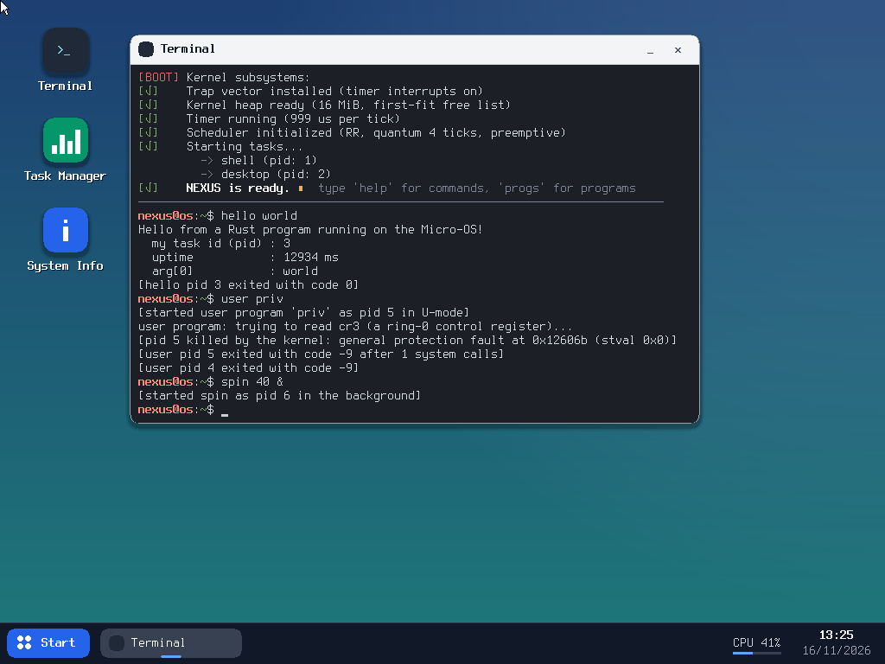
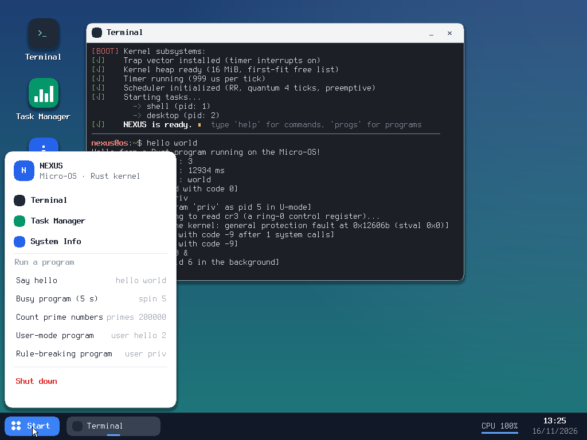
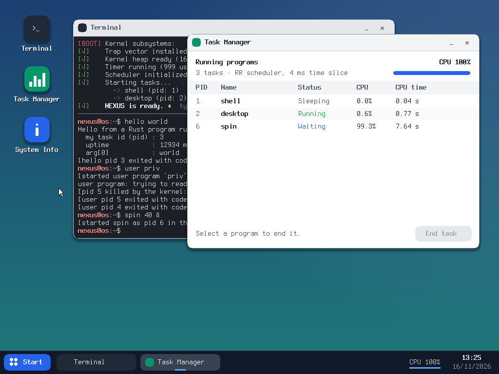
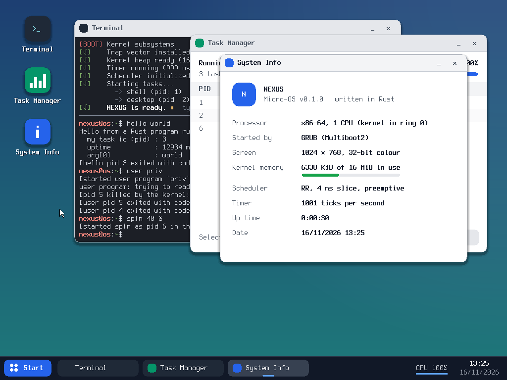

# Micro-OS on a PC: the x86-64 port (bootable ISO with a desktop)

The kernel runs on two architectures from **one source tree**, and on a PC it
draws an everyday desktop (wallpaper, icons, windows, taskbar, Start menu,
clock, mouse) by itself. No emulator is involved when it runs in VirtualBox,
VMware or on a real PC.



| | RISC-V (original) | x86-64 (PC, VirtualBox, VMware) |
|---|---|---|
| Firmware / loader | OpenSBI | GRUB, Multiboot2 |
| Entry | `boot/entry.S` (S-mode) | `x86/boot.S`: 32-bit stub → page tables (4 GiB) → long mode → `kmain` |
| Console | NS16550 UART | graphics framebuffer (set by GRUB) with a bitmap font; VGA text mode as fallback; COM1 too |
| Input | serial | PS/2 keyboard and **PS/2 mouse** |
| Timer | SBI timer, `time` CSR | 8254 PIT through the 8259 PIC (1 ms); TSC calibrated against the PIT; RTC for the date |
| Traps | `stvec`, `trap.S` | IDT, `x86/trap.S` |
| Context switch | `task/switch.S` | `task/switch_x86.S` |
| User mode | U-mode, `ecall`, `sscratch` | ring 3, `int 0x80`, `TSS.rsp0` |
| Boot arguments | device tree `bootargs` | Multiboot2 command line |
| Power off | QEMU test device / SBI | ACPI ports (VirtualBox, QEMU, Bochs) |

Only these hardware modules differ; `main.rs` picks them with
`#[cfg_attr(target_arch = "x86_64", path = "x86/...")]`. The scheduler and
its 8 policies, synchronisation, the allocator, user-mode system calls, the
shell, the programs, the R3 research code and every test scenario are shared.
Time is kept in the same 100 ns unit on both ports.

## The desktop (`x86/drivers/gui/`)

The desktop is an ordinary kernel task named `desktop`: the scheduler shares
the CPU between it, the shell and your programs, so it shows up in its own
Task Manager. It starts only if GRUB gave the kernel a 32-bit graphics mode;
otherwise the shell uses the VGA text screen as before.

* **Terminal**: the kernel shell in a window (80 × 25, colours). Everything
  typed goes to the shell; `exit` shuts the machine down.
* **Task Manager**: every task with status, CPU share and CPU time from the
  scheduler, the CPU meter, and **End task** (asks the task to stop, like `kill`).
* **System Info**: kernel memory in use, scheduler and time slice, timer rate,
  screen mode, up time and the PC's clock.
* **Start menu**: open the apps, run a program (say hello, a busy program,
  count primes, a user-mode program, a program the kernel stops), or shut down.
* Windows can be dragged, minimised and closed; the taskbar shows the open
  ones; double-click a desktop icon to open it.

All numbers come from the running kernel; nothing is simulated.

| | Screenshot |
|---|---|
| Start menu |  |
| Task Manager (a busy program at 99% CPU) |  |
| System Info |  |

## Build and run

```bash
scripts/build_x86_iso.sh          # -> micro-os-x86.iso (about 17 MB)
```

GRUB menu: **desktop** (default), run all tests, desktop under SJF or MLFQ.

VirtualBox: New VM, type *Other*, version *Other/Unknown (64-bit)*, 256 MB RAM
(or more), no hard disk, display adapter **VBoxVGA** or VMSVGA; Settings →
Storage → optical drive → `micro-os-x86.iso`; Start. Click inside the window to
use the mouse (VirtualBox captures it; press the right Ctrl key to release it).
VMware: guest *Other 64-bit*, BIOS firmware. A PC: write the ISO to a USB stick
and boot it in legacy BIOS (CSM) mode.

## Verified

* x86-64: the full in-kernel suite, **68 of 68 checks pass**, with the desktop
  code in the kernel.
* The desktop was driven with a (virtual) PS/2 mouse and keyboard: Start menu
  open and close, running programs from the menu, Task Manager listing a busy
  program at 99% CPU, **End task** stopping it, System Info, Shut down (the
  machine powers off through ACPI).
* RISC-V after the port: 34 unit tests, 68/68 checks, byte-identical logs
  across two boots, shell smoke test.
* Not run: VirtualBox and VMware themselves (not installed on the development
  PC). Tests used QEMU's PC machine, which has the same VGA, PS/2, PIT and RTC
  hardware.

## Limits

* BIOS boot only; a UEFI-only PC needs CSM/legacy mode.
* Ring 3 is privilege separation, not memory isolation (identity-mapped,
  user-accessible pages).
* One CPU; the mouse and keyboard are polled; the desktop repaints the whole
  screen when something changes (fast in a VM, not tuned for slow machines).
* The desktop has three apps; it is deliberately small, not a full window system.
