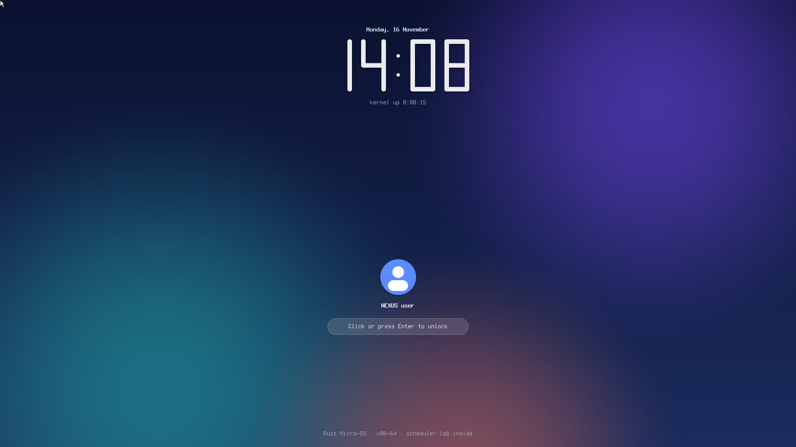
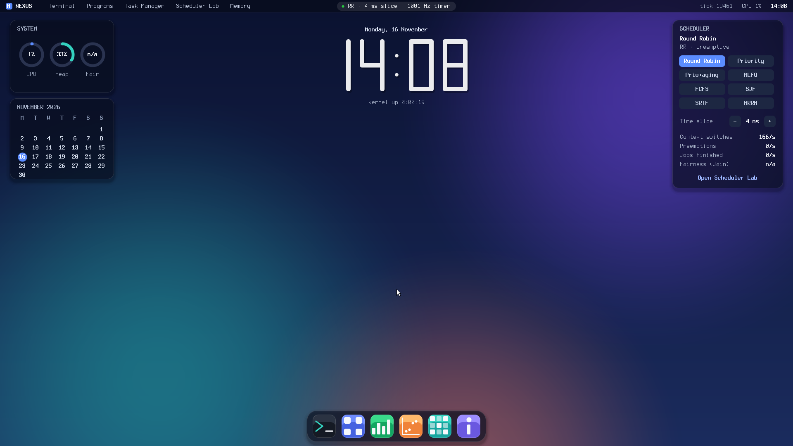
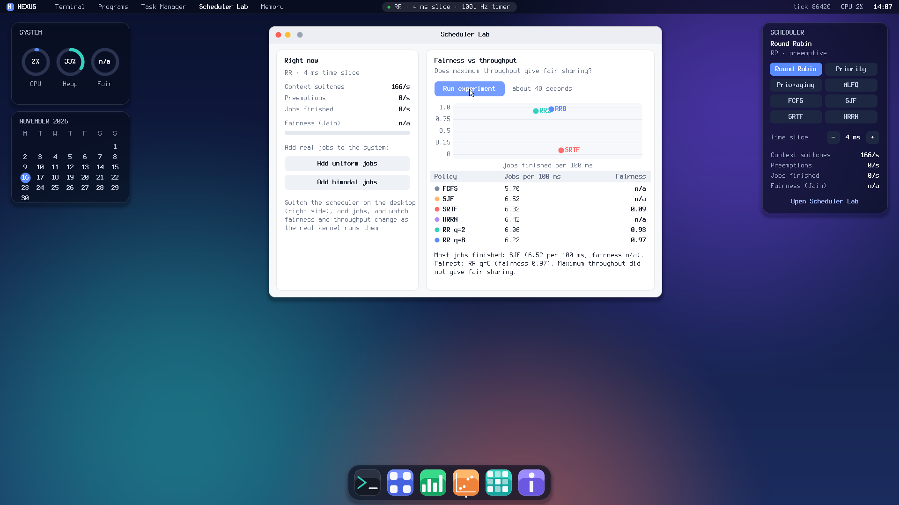

**JAIN (DEEMED-TO-BE UNIVERSITY)**
Faculty of Engineering & Technology
Department of Computer Science & Engineering

**OPERATING SYSTEMS LABORATORY**
**CONTINUOUS ASSESSMENT 6 (CA-6): RUST MICRO-OS**
**Porting the Rust Micro-OS Kernel to x86-64 and Running It in VirtualBox**
Course Code: 25PCCS201 | Semester: III

| | |
|---|---|
| Student Name | TASHVI ADHLAKHA |
| USN | 25BTRCL271 |
| Program / Branch | B.Tech Computer Science and Engineering (AIML) |
| Semester / Section | Semester 3, Section E |
| Academic Year | 2026–2027 |
| Assessment | CA-6 – x86-64 port (part of the Rust Micro-OS project) |
| Language / Tools | Rust 1.99.1 (`no_std`, target `x86_64-unknown-none`), GNU assembler, GRUB 2.12, Oracle VirtualBox, QEMU 8.2.2 |
| Date of Submission | 16 November 2026 |

---

## Contents

1. Title and Summary
2. Engineering Question
3. Objective
4. OS Concept
5. Experimental Environment
6. Design and Implementation
7. Running the Kernel in VirtualBox
8. Results
9. Discussion
10. Limitations
11. AI Disclosure
12. Conclusion

References
Appendix A – Reproduction Steps and Submission Checklist

---

## 1. Title and Summary

**Title.** Porting the Rust Micro-OS Kernel to x86-64 and Running It in VirtualBox with Its Own Desktop.

**Summary.** In this part of the project I took the Rust Micro-OS kernel, which was written for RISC-V and runs in QEMU, and ported it to the x86-64 architecture so that it boots on a PC. I packaged it as a bootable ISO with GRUB and Multiboot2 and ran it in **Oracle VirtualBox**, where the Rust kernel takes over the virtual machine and draws its own full-screen desktop. No emulator runs inside the VM.

Only the hardware layer had to change: boot, traps, timer, keyboard, mouse, screen and power-off. The scheduler and its 8 policies, synchronisation, the heap allocator, user-mode system calls, the shell, the programs and every test scenario are shared with the RISC-V build. My main results are: (i) all **68 of 68 in-kernel checks pass on x86-64**, the same suite as on RISC-V; (ii) the kernel switches VirtualBox's graphics card itself to full screen (up to 1920 × 1080), because VirtualBox's BIOS only offers small modes; and (iii) the desktop runs as an ordinary kernel task with a Terminal, Programs, Task Manager, **Scheduler Lab**, Memory and System Info, and every number on it comes from the running kernel.

## 2. Engineering Question

Can the same Rust kernel source run on a second, very different processor architecture (x86-64) and boot on a PC in VirtualBox, with only the hardware layer rewritten, while every scheduling, synchronisation, memory and system-call test still passes?

My question names the OS mechanism (the hardware abstraction boundary of a kernel), what I change (the target architecture and the machine), and how I judge success (the same 68 in-kernel checks, and a working desktop in VirtualBox).

## 3. Objective

My objectives were to:

- boot the Rust kernel on x86-64 from a standard bootable ISO, with no emulator inside the virtual machine;
- keep a single source tree, so that only hardware-specific modules differ between RISC-V and x86-64;
- run the full in-kernel test suite on x86-64 and compare it with RISC-V;
- give the kernel its own full-screen desktop in VirtualBox, showing live data from the scheduler and allocator;
- run a small version of the R3 study (*Fairness vs Throughput in CPU Scheduling*) live on the PC, in a Scheduler Lab window.

## 4. OS Concept

### 4.1 The hardware abstraction boundary

A portable kernel separates **policy** (which task runs next, how memory is handed out, what a system call does) from **mechanism that depends on the hardware** (how the CPU enters the kernel, how the timer interrupts, how a context is saved). If that boundary is clean, a port only rewrites the mechanism. In Micro-OS, `main.rs` chooses the hardware modules at compile time with `#[cfg_attr(target_arch = "x86_64", path = "x86/...")]`; everything else is compiled unchanged.

### 4.2 What differs between the two architectures

| Mechanism | RISC-V (original) | x86-64 (PC, VirtualBox) |
|---|---|---|
| Firmware and loader | OpenSBI | GRUB 2, Multiboot2 |
| Entry | `boot/entry.S` in S-mode | `x86/boot.S`: 32-bit stub → page tables (identity map, 4 GiB) → long mode → `kmain` |
| Console | NS16550 UART | framebuffer set by GRUB, with a bitmap font; VGA text mode as fallback; COM1 serial too |
| Input | serial | PS/2 keyboard and PS/2 mouse |
| Timer | SBI timer, `time` CSR | 8254 PIT through the 8259 PIC at 1 ms; TSC calibrated against the PIT; RTC for the date |
| Traps | `stvec`, `trap.S` | IDT, `x86/trap.S` |
| Context switch | `task/switch.S` | `task/switch_x86.S` |
| User mode | U-mode, `ecall`, `sscratch` | ring 3, `int 0x80`, `TSS.rsp0` |
| Boot arguments | device tree `bootargs` | Multiboot2 command line |
| Power off | QEMU test device / SBI | ACPI ports (VirtualBox, QEMU, Bochs) |

Time is kept in the same 100 ns unit on both ports, so scheduling measurements are directly comparable.

## 5. Experimental Environment

| Parameter | Value |
|---|---|
| Kernel language | Rust 1.99.1, `no_std`, target `x86_64-unknown-none`, release build |
| Build host | Ubuntu in WSL2 on Windows 11 |
| Boot loader | GRUB 2.12 (`grub-mkrescue`), Multiboot2 |
| Virtual machine | Oracle VirtualBox: VM type *Other*, version *Other/Unknown (64-bit)*, 256 MB RAM, no hard disk, VBoxVGA/VMSVGA display, ISO in the optical drive, BIOS boot |
| VirtualBox version | *(fill in: Help → About VirtualBox)* |
| Automated test machine | QEMU 8.2.2 PC machine (`qemu-system-x86_64`, 256 MB): the same VGA, PS/2, PIT and RTC hardware, used to run the suite without a person at the keyboard |
| Workload | the full in-kernel suite: TC1–TC6, scheduling, synchronisation, memory, system calls, R3 quick run (68 checks) |
| Date of experiment | 16 November 2026 |

## 6. Design and Implementation

### 6.1 Boot path

GRUB loads the kernel ELF through Multiboot2 and asks for a 32-bit graphics mode. `x86/boot.S` starts in 32-bit protected mode, builds identity-mapped page tables for the first 4 GiB, enables long mode and jumps to the shared `kmain`. The Multiboot2 command line plays the role of RISC-V's `bootargs`, so the same options work (`test=all`, `policy=sjf`, and so on).

### 6.2 Full screen in VirtualBox (`gui/modeset.rs`)

GRUB can only use the modes the PC's BIOS lists, and VirtualBox's BIOS lists few, often only 640 × 480. VirtualBox's graphics card, like QEMU's, also implements the **Bochs VBE** register interface, which can set any resolution that fits in video memory. If GRUB left the kernel in a small mode and that interface is present, the kernel switches to the largest mode up to 1920 × 1080 itself. The framebuffer address does not change, only its size and pitch.

### 6.3 The desktop (`x86/drivers/gui/`)

The desktop is an ordinary kernel task named `desktop`. The scheduler shares the CPU between it, the shell and any programs, so it appears in its own Task Manager. Drawing is immediate-mode: each frame is composed in an off-screen canvas, and the clickable areas are recorded as they are drawn.

| Part | What it shows or does |
|---|---|
| Lock screen | large clock, date and kernel up-time; Enter or a click unlocks |
| Menu bar | NEXUS menu, app menus, the scheduling policy, time slice and timer rate, tick count, CPU use and the clock |
| Widgets | System (CPU, heap and fairness gauges), a calendar from the PC's RTC, and a Scheduler panel to switch between all 8 policies and change the time slice live |
| Dock | Terminal, Programs, Task Manager, Scheduler Lab, Memory, System Info |
| Terminal | the kernel shell itself in a window |
| Programs | starts the kernel's programs, including user-mode ones and one the kernel stops |
| Task Manager | every task with state, CPU share and CPU time, with **End task** |
| Scheduler Lab | live dispatches, preemptions, jobs finished per second and Jain's index every 250 ms, plus a small R3 run: each of the six R3 policies on a bimodal workload at load 1.1, as real kernel tasks |
| Memory | kernel heap use from the allocator |
| System Info | memory in use, scheduler and time slice, timer rate, screen mode, up-time and the PC clock |

### 6.4 Size of the port

| Module | Lines |
|---|---:|
| Boot, traps, timer, arch glue (`boot.S`, `boot.rs`, `trap.S`, `trap.rs`, `timer.rs`, `arch.rs`) | 787 |
| Drivers: VGA, UART, keyboard, power-off (`drivers/*.rs`) | 586 |
| Desktop (`drivers/gui/`: desktop, canvas, apps, Scheduler Lab, input, font, RTC, mode-set) | 2,757 |
| **Total x86-specific code** | **4,130** |

The rest of the kernel is shared with RISC-V without changes.

## 7. Running the Kernel in VirtualBox

### 7.1 Procedure

1. I built the ISO in WSL with `scripts/build_x86_iso.sh`, which writes `micro-os-x86.iso` (about 18 MB).
2. In VirtualBox I created a new VM: type *Other*, version *Other/Unknown (64-bit)*, 256 MB RAM, no hard disk.
3. In Settings → Display I chose the VBoxVGA (or VMSVGA) graphics controller.
4. In Settings → Storage I attached `micro-os-x86.iso` to the optical drive.
5. I started the VM. GRUB shows four entries: the desktop (default), run all tests, the desktop under SJF, and the desktop under MLFQ.
6. The kernel boots, switches the screen to full resolution and shows the lock screen. Clicking inside the window lets VirtualBox capture the mouse (the right Ctrl key releases it); Enter unlocks.
7. On the desktop, the Terminal runs shell commands, Programs starts the kernel's programs, the Task Manager shows them and can end them, the Scheduler panel switches policy, and the Scheduler Lab runs the R3 measurements.
8. Shut down in the menu powers the VM off through ACPI.

### 7.2 Screenshots

| Screen | Screenshot |
|---|---|
| Lock screen at 1920 × 1080, after the kernel's own mode-set |  |
| Desktop: menu bar, System and calendar widgets, Scheduler panel with all 8 policies, dock |  |
| Scheduler Lab after a run: SJF finished the most jobs (6.52 per 100 ms), RR q=8 was the fairest (Jain 0.97) |  |

These pictures were captured on 16 November 2026 from the same ISO that runs in VirtualBox. *(Add your own VirtualBox screenshots here: in VirtualBox, View → Take Screenshot.)*

## 8. Results

### 8.1 Test suite

| Architecture | Machine | In-kernel checks | Notes |
|---|---|---|---|
| RISC-V 64 | QEMU `virt` | **68 / 68 passed** | plus 34 host unit tests; byte-identical logs across boots |
| x86-64 | QEMU PC machine | **68 / 68 passed** | run again on 16 November 2026: `==== checks: 68 passed, 0 failed ====` |
| x86-64 | VirtualBox | *(fill in after choosing "run all tests" in GRUB)* | the same ISO and suite |

At shutdown on x86-64 the heap reported 39,728 bytes in use after 4,796 allocations and 4,783 frees. It rejected 3 bad frees and 1 oversized request, which are the failure cases TC5 makes on purpose.

### 8.2 Desktop

I booted the ISO in VirtualBox and used the desktop there by hand. During development the desktop was also driven with a virtual PS/2 mouse and keyboard in QEMU's PC machine, which confirmed:

- the kernel switches to full resolution (1920 × 1080) and draws the lock screen and desktop;
- the mouse and keyboard work: menus, the dock and windows respond, and the Terminal accepts shell commands;
- the Task Manager lists live tasks; a busy program reached 99% CPU, and **End task** stopped it;
- Shut down powers the machine off through ACPI.

*(Add what you observed in VirtualBox, for example the screen resolution it reached and any problems.)*

## 9. Discussion

**The boundary held.** The port touched only boot, traps, timer, input, screen and power-off. Because the scheduler, allocator, synchronisation and system calls were never edited, passing the same 68 checks on both architectures is strong evidence that those parts do not depend on RISC-V.

**User mode needed a new entry route, not new rules.** RISC-V enters the kernel with `ecall` and switches stacks with `sscratch`; x86-64 uses `int 0x80` and the TSS's `rsp0`. The system-call numbers, argument checks and error codes (`-EFAULT`, `-ENOSYS`) stayed the same, and so did the rule that a privileged instruction kills only the offending program (a general protection fault in ring 3).

**VirtualBox was the reason for the mode-set.** VirtualBox's BIOS lists only a few small screen modes, so through GRUB alone the desktop came up small. Setting the mode directly through the Bochs VBE registers, which VirtualBox's card supports, gives a full-screen desktop without depending on what the BIOS lists.

**The desktop is a real task.** The desktop is scheduled like any other task, so it competes for the CPU with the shell and the programs, and it appears in its own Task Manager.

## 10. Limitations

- **BIOS boot only.** A UEFI-only PC needs CSM/legacy mode; in VirtualBox, EFI must stay off.
- **No memory isolation.** Ring 3 gives privilege separation, but pages are identity-mapped and user-accessible, so user programs are not isolated from each other.
- **One CPU.** The kernel uses a single core.
- **Polling and full redraws.** The mouse and keyboard are polled, and the desktop recomposes the whole screen when something changes. This is fast in a VM but not tuned for slow machines.
- **Small desktop.** It is deliberately small, not a full window system.
- **Automated runs used QEMU.** The repeatable test run and the screenshots above came from QEMU's PC machine, which has the same VGA, PS/2, PIT and RTC hardware; VirtualBox was used for running the desktop by hand.

## 11. AI Disclosure

| Item | Details |
|---|---|
| AI tool used | Claude (Opus 5.5 and Sonnet 5.5), developed by Anthropic, through Claude Code |
| Purpose | to help write the x86-64 hardware layer, the desktop, the Bochs VBE mode-set and the Scheduler Lab, and to draft this document |
| Verification | I re-ran the full in-kernel suite on x86-64 on 16 November 2026 (68 of 68 checks passed), booted the ISO in VirtualBox and used the desktop myself, and checked the statements in this document against the code and the test log |
| Reflection | *(fill in: what you changed yourself, and which parts you can explain in the viva)* |

## 12. Conclusion

The Rust Micro-OS kernel now runs on two architectures from one source tree. On x86-64 it boots from a standard ISO in VirtualBox, sets its own full-screen mode, and runs a desktop that is itself a scheduled kernel task, with a Scheduler Lab that runs the R3 fairness-versus-throughput study live. Only about 4,100 lines of hardware-specific code were needed, and all 68 in-kernel checks pass on both RISC-V and x86-64. This shows that the kernel's scheduling, synchronisation, memory and system-call mechanisms are portable, within the limits above: BIOS boot, one CPU and no memory isolation.

## References

1. Silberschatz, A., Galvin, P. B. and Gagne, G. *Operating System Concepts*, Wiley – chapters on CPU scheduling and on operating-system structures.
2. Tanenbaum, A. S. and Bos, H. *Modern Operating Systems*, Pearson – chapters on processes, scheduling and input/output.
3. Intel Corporation. *Intel 64 and IA-32 Architectures Software Developer's Manual* – long mode, the IDT and the TSS.
4. GNU GRUB. *The Multiboot2 Specification*.
5. Oracle. *Oracle VirtualBox User Manual*.
6. CA-6: Rust Micro-OS – assessment brief, Operating Systems course, Jain (Deemed-to-be University).

## Appendix A – Reproduction Steps and Submission Checklist

### A.1 Reproduction steps

1. In WSL, from `~/micro-os`, run `scripts/build_x86_iso.sh`. It builds the kernel for `x86_64-unknown-none` and writes `micro-os-x86.iso`.
2. In VirtualBox, create a VM as in Section 7.1 and boot the ISO.
3. Choose *run all tests* in the GRUB menu to run the suite, or the default entry for the desktop.
4. Without VirtualBox, the same suite runs in QEMU: `DEFAULT=1 OUT=/tmp/x86-tests.iso scripts/build_x86_iso.sh`, then `qemu-system-x86_64 -cdrom /tmp/x86-tests.iso -m 256 -display none -serial file:x86-tests.log`. The log ends with `==== checks: 68 passed, 0 failed ====`.

### A.2 Submission checklist

| Item | Status |
|---|---|
| Engineering question clearly stated | Done (Section 2) |
| OS concept explained | Done (Section 4) |
| Language, tools and versions documented | Done (Section 5) |
| VirtualBox set-up documented | Done (Sections 5 and 7) |
| Implementation described | Done (Section 6) |
| Test results on both architectures | Done (Section 8.1) |
| Desktop verified in VirtualBox | Done (Section 8.2) |
| Screenshots | Done (Section 7.2); own VirtualBox screenshots to add |
| Limitations stated | Done (Section 10) |
| AI use disclosed | Done (Section 11); reflection to fill in |
| Reproducible | Done (Appendix A.1) |
